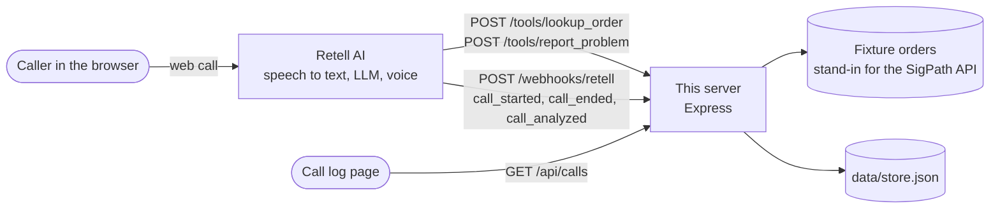

# SigPath Voice

A phone support agent for [SigPath](https://sigpath.vercel.app) orders, built on Retell AI. Callers can check an order, report a problem, or ask for a person.

I built it to learn how Retell agents are put together and debugged, the way a support engineer would set one up for a customer. The orders are fixtures. I'm a 2026 CS graduate and this is a demo: it hasn't taken real customer calls, and I haven't run telephony in production.

## What it covers

| Part of the job | Where it lives |
| --- | --- |
| Build a voice agent: prompt, custom functions, call transfer | [src/agent/config.ts](src/agent/config.ts), applied with `npm run setup-agent` |
| Hook a customer's API up to the agent | [src/app.ts](src/app.ts) `POST /tools/:name`, signed with `X-Retell-Signature` |
| Webhooks and post-call analysis | `POST /webhooks/retell`, stored once per call and event |
| Debug a call: latency, failed tools, hallucinations, transcripts | [public/calls.html](public/calls.html) and [src/analysis.ts](src/analysis.ts) |
| Write it up afterwards | [docs/incident-example.md](docs/incident-example.md) |

## How it fits together



Retell does the talking. My server answers 2 things: tool requests during the call, and lifecycle webhooks after it. Both are signed with the API key, and the server checks the signature on the raw body before it parses anything. A request with a bad signature gets a 401.

A few choices worth knowing about:

- **Tools return instructions along with data.** When an order isn't found, the result says so and tells the agent to read the number back. Without that, the LLM tends to fill the gap with a plausible status.
- **Retries are safe.** Retell retries a tool when `max_retry` is above 0, and a webhook up to 3 times. Ticket ids come from a hash of call, order and category, and webhooks are stored once per `(call_id, event)`, so a retry never makes a second ticket or a second row.
- **Webhooks answer 204 right away.** Retell gives up after about 10 seconds.
- **Spoken order ids get cleaned up.** "S P one oh four two", "double four" and "1042" all become `SP-1042`.
- **SP-1099 always fails** with a 503, so there's a broken path to look at on purpose.

## Run it

You need Node 20 or newer. These steps cost nothing: web calls run in the browser and don't need a phone number.

**1. Install and test**

```bash
npm install
```

```bash
npm test
```

**2. Try the call log offline (optional)**

This works before you have a Retell account. Put any value in `RETELL_API_KEY` in `.env` (for example `local-test`), then:

```bash
npm start
```

```bash
npm run simulate
```

Open http://localhost:3000/calls.html. You'll see a normal call and an incident call with a failed tool and a flagged hallucination.

**3. Sign up for Retell**

Make an account at [retellai.com](https://www.retellai.com). From the dashboard, copy the API key and the public key into `.env` (copy `.env.example` first). Add `localhost` to the public key's allowed domains, or the browser call gets refused.

**4. Open a tunnel**

Retell has to reach your laptop over https. With [cloudflared](https://developers.cloudflare.com/cloudflare-one/connections/connect-networks/downloads/):

```bash
cloudflared tunnel --url http://localhost:3000
```

Put the `https://....trycloudflare.com` URL it prints into `PUBLIC_BASE_URL`. Quick tunnels get a new URL each time, so rerun step 5 when it changes.

**5. Create the agent**

```bash
npm run setup-agent
```

It creates the LLM and the agent and prints `RETELL_LLM_ID` and `RETELL_AGENT_ID`. Paste both into `.env`. Later runs update the same agent instead of making new ones.

**6. Make the first call**

```bash
npm start
```

Open http://localhost:3000, click **Call SigPath support** and allow the microphone. Ask about SP-1042. When you hang up, the call shows up in the call log within a few seconds, and the post-call analysis shows up a bit after that.

Transfers need a real phone call, so they wait until there's a number on the account and `TRANSFER_NUMBER` is set.

## Debugging playbook

What I check, roughly in order, when a call goes wrong:

1. **Did the webhooks arrive?** The call log lists the events it got. If tool calls show up but no webhooks, the agent's `webhook_url` is wrong (usually an old tunnel URL).
2. **Did a tool fail?** Failed tools are red, with the HTTP status and the result the LLM saw. A 401 in the server log means the signature check failed: wrong API key in `.env`, or something rewrote the body on the way in.
3. **Was it slow?** Compare end-to-end p90 with how long the tool took on my server. If the server was fast and the call was still slow, look at LLM latency next. To reproduce a slow API, set `TOOL_DELAY_MS=6000`.
4. **Did the agent make something up?** The log flags order ids the agent said without a successful lookup. Then I read the transcript around that turn and tighten the prompt or the tool's error message.
5. **What did post-call analysis say?** `call_successful`, `resolved` and `issue_category` show whether this is one call or a pattern.
6. **Write it up.** Template and example: [docs/incident-example.md](docs/incident-example.md).

For anything the local log doesn't show, the call detail links to Retell's public log for that call.

## Files

```
src/server.ts          starts the server
src/app.ts             routes, signature check, tool and webhook handling
src/agent/config.ts    prompt, tools, voice, post-call analysis fields
src/tools/             orders (fixtures, id cleanup), problems (tickets), handlers
src/analysis.ts        builds the call view and the flags
src/web/call.ts        browser web call, bundled to public/build/call.js
public/                web call page and call log
scripts/setup-agent.ts creates or updates the Retell LLM and agent
scripts/simulate.ts    sends signed fake calls to the local server
test/                  vitest
```
